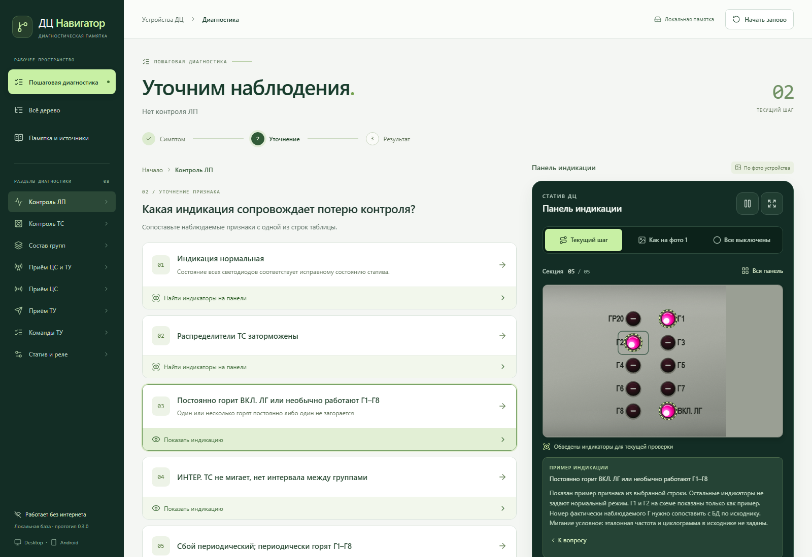
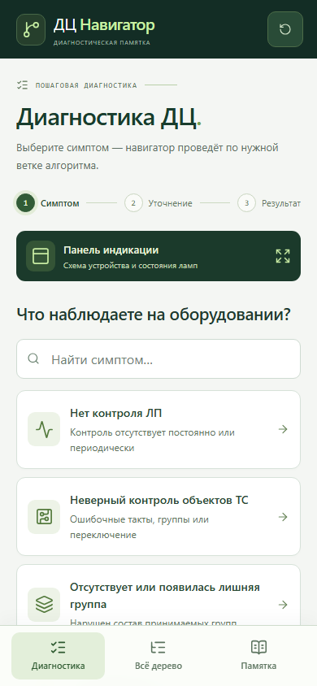
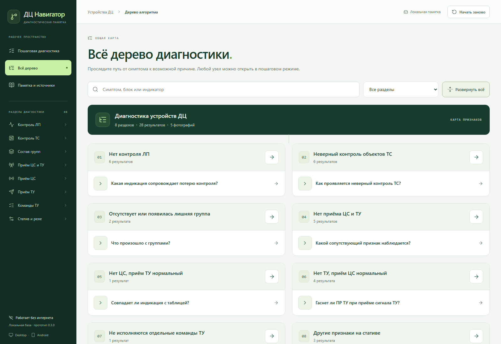

# ДЦ Навигатор

Офлайн-приложение для пошаговой диагностики устройств ДЦ на **Windows и Android**. Превращает табличную памятку в интерактивный маршрут: симптом → уточняющие вопросы → возможные причины с указанием источника.

**React · JavaScript · Electron · Capacitor · Vite · Playwright**

[Скачать v0.3.0](https://github.com/nazar987/Step-by-step-diagnostic-navigator/releases/tag/v0.3.0) · [Разработка и сборка](docs/DEVELOPMENT.md) · [Продолжить на другом компьютере](HANDOFF.md)



## Задача

Исходные материалы — пять фотографий панели и диагностических таблиц. В бумажной памятке нужно вручную сопоставлять симптом, индикацию и возможную причину. Приложение организует эти сведения в единое дерево и помогает пройти подходящую ветку, сохраняя доступ к оригиналам.

В базе **8 разделов, 40 узлов и 28 диагностических результатов**. Панель содержит **50 интерактивных SVG-индикаторов**.

## Возможности

- **Пошаговая диагностика** с уточняющими вопросами, возвратом к предыдущим шагам и историей маршрута.
- **Полное дерево** с поиском по симптомам и блокам, фильтром разделов, сворачиванием веток и переходом к любому узлу.
- **Интерактивная панель** с общим видом и читаемыми секциями, подсветкой, миганием, паузой и ручной настройкой состояний.
- **Два вида подсказок:** показать описанное состояние или найти связанные индикаторы, если их режим в источнике не задан.
- **Локальные заметки и сохранение маршрута** между запусками на одном устройстве.
- **Памятка и исходные фотографии** со ссылками из результатов диагностики.
- **Адаптивный интерфейс** для ПК и телефона, нижняя мобильная навигация, клавиатурное управление и поддержка уменьшения анимации.

Для установленного приложения интернет не нужен: диагностическая база, изображения и интерфейс входят в сборку. Сервер, регистрация и облачная синхронизация не используются.

## Экраны

| Мобильная диагностика | Дерево алгоритма |
| --- | --- |
|  |  |

## Скачать

Готовые сборки доступны в [GitHub Release v0.3.0](https://github.com/nazar987/Step-by-step-diagnostic-navigator/releases/tag/v0.3.0).

| Платформа | Файл |
| --- | --- |
| Windows x64, portable | `DC-Navigator-0.3.0-Windows-x64.exe` |
| Android 7.0+ — API 24, актуальный WebView | `DC-Navigator-0.3.0-Android.apk` |
| Контрольные суммы | `SHA256SUMS.txt` |

Windows EXE не требует установки и не подписан сертификатом издателя. Android APK подписан release-ключом; проверка на физическом Android-устройстве пока не выполнена.

## Быстрый старт

Требуются Node.js 24+ и npm.

```sh
git clone https://github.com/nazar987/Step-by-step-diagnostic-navigator.git
cd Step-by-step-diagnostic-navigator
npm ci
npm run dev
```

Интерфейс будет доступен по адресу `http://127.0.0.1:5173`.

Для запуска в Electron:

```sh
npm run desktop:dev
```

При первом desktop-запуске скрипт загружает бинарник Electron, если он ещё отсутствует. Требования Android SDK/JDK, упаковка и подпись описаны в [руководстве разработчика](docs/DEVELOPMENT.md).

## Архитектура

| Часть | Реализация |
| --- | --- |
| Интерфейс | React и JavaScript; Vite для разработки и production-сборки |
| Алгоритм | `src/data/diagnostics.js`: вопросы, переходы, причины, ссылки на источники |
| Связь с панелью | `src/data/indication.js`: связанные индикаторы и классификация подсказок |
| Визуализация оборудования | `src/data/panel.js` и `src/components/Panel.jsx`: геометрия, маркировки, состояния SVG |
| Хранение | `localStorage`: маршрут и заметка на текущем устройстве |
| Windows | Electron; изолированный renderer с выключенным `nodeIntegration` |
| Android | Capacitor; тот же React-интерфейс внутри нативного приложения |
| Проверки | Node.js test runner, Playwright и программная проверка загрузки Electron |

## Решения в реализации

- **Один граф для двух режимов.** Пошаговый экран и полное дерево используют общие данные; изменение алгоритма не требует дублировать переходы в интерфейсе.
- **Состояние отделено от расположения.** Подсказки различают `pattern`, `location` и `none`. Неизвестный режим не превращается в «выключено», а явно погашенная лампа остаётся заданным состоянием.
- **Привязка к первоисточнику.** У результатов сохранены номера фотографий, описание исходной строки и примечания к неоднозначным обозначениям.
- **SVG вместо статичного изображения.** Панель сохраняет расположение индикаторов; секции и выбор лампы позволяют работать с ней на небольшом экране.
- **Общий код для двух платформ.** Диагностическая логика и интерфейс используются в Electron и Capacitor без отдельных реализаций алгоритма.
- **Разделение сборки и подписи Android.** GitHub Actions собирает неподписанный APK; release-подпись выполняется локально. Пароль ключа защищён Windows DPAPI, секреты не передаются в CI.

## Проверки

Пройдены **18 модульных тестов**, **17 браузерных сценариев** и программная проверка загрузки production-интерфейса в Electron. Проверяются достижимость результатов, переходы, классификация индикации, сохранение состояния, навигация, источники и адаптивность на ширинах от 320 до 1440 px.

```sh
npm test
npm run build
npx playwright install chromium
npm run test:e2e
node scripts/test-desktop.mjs
```

Браузерные сценарии и проверка Electron подтверждают работу интерфейса и логики; они не заменяют проверку APK на устройстве.

## Материалы и статус

Проект — развиваемый прототип диагностической памятки. База организована по пяти исходным фотографиям (`public/sources/`), а геометрия панели уточнена по `docs/panel-reference.png`. Выводы содержат возможные причины и требуют технической сверки. Подсветка иллюстративная: подключения к оборудованию нет, эталонная циклограмма нормальной индикации пока не задана.

## Лицензия

[MIT](LICENSE).
